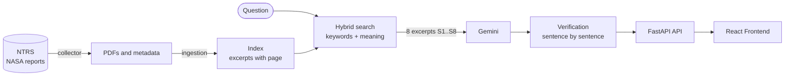

# Flame in Freefall

**Microgravity combustion · NASA open data**

A tool to query what NASA has published on fire in microgravity and spacecraft fire safety,
without having to read dozens of technical reports. It answers questions in Portuguese, shows under
what conditions a flame spreads or extinguishes, and indicates the document and page where each
statement comes from.

> Independent project built with open data. It is not an official NASA product nor is it endorsed by NASA.


*"Overview" screen with demo data (synthetic, not NASA results).*

## Why

In space, fire behaves differently. Without gravity, hot air does not rise, the flame becomes
spherical and blue, and it can sustain itself with less oxygen and less airflow than on Earth.
Knowing the conditions under which a material burns is what makes it possible to design safe
spacecraft. This information is public, but it is scattered across lengthy PDFs on the NASA
Technical Reports Server (NTRS).

## What it does

- **Flammability map:** one point per experiment, with oxygen concentration on one axis and
  pressure or flow velocity on the other. The shape of the point indicates whether the flame spread
  or extinguished.
- **Experiments table:** fuel, oxygen, pressure, flow, and outcome, with filters, sorting, details
  for each experiment, and side-by-side comparison of 2 or 3 experiments.
- **Assistant:** free-form questions in Portuguese about the documents. Every sentence in the answer
  cites its source, and clicking the citation opens the original excerpt.
- **Summaries and conclusions:** a summary of each document and answers to fixed questions about
  fire safety, labeled "Verified" or "Unverified".

## The core rule: no claim without a source

The language model only sees the excerpts retrieved from the documents and is required to cite an
excerpt at the end of each sentence. Before the answer is returned, each sentence passes through
three checks:

1. **Valid citation:** the sentence cites an excerpt that exists.
2. **Numbers in the source:** all numbers in the sentence appear in the cited excerpt.
3. **Support:** a second call to the model, acting as a judge, confirms that the excerpt supports the sentence.

The answer is only marked as reliable if all sentences pass. When it fails, the interface displays
a warning and underlines unsupported sentences. If the documents do not answer the question, the
response is "I did not find this information in the documents."

## How it works



1. **Collection:** the collector queries the public NTRS API and downloads the PDFs.
2. **Ingestion:** text is extracted page by page and split into chunks of about 1200 characters
   without breaking sentences. Each chunk stores its source document and page.
3. **Hybrid search:** combines keyword search (BM25) with semantic search (multilingual
   embeddings), allowing queries in Portuguese over documents in English.
4. **Answer:** the most relevant excerpts are sent to the model, numbered `S1`, `S2`…
5. **Verification:** the answer is checked sentence by sentence, as described above.
6. **Extraction:** for each document, fuel, environment, pressure, oxygen, flow velocity, and
   outcome are extracted, each value with its source. This data feeds the map and the table.

## Repository structure

| Folder | Contents |
|---|---|
| [`Backend/`](Backend/) | Python service (FastAPI): collector, ingestion, search, RAG, verification, API, and CLI. Full documentation in [`Backend/README.md`](Backend/README.md). |
| [`Frontend/nasa-fire-dashboard/`](Frontend/nasa-fire-dashboard/) | Web application (React, TypeScript, Tailwind, Recharts). See [`README.md`](Frontend/nasa-fire-dashboard/README.md). |
| [`docs/`](docs/) | Documentation images. |

## How to run

### Frontend only, with demo data

Does not require the Backend or an API key. Requires Node 20.19 or higher.

```bash
cd Frontend/nasa-fire-dashboard
npm install
npm run dev
```

Without the `.env` file, the application uses synthetic data and displays the "Demo data" label.

### Full system, with real documents

**1. Backend** (Python 3.11 or higher):

```bash
cd Backend
python -m venv .venv
source .venv/bin/activate          # Windows: .venv\Scripts\activate
pip install -r requirements.txt
cp .env.example .env               # and fill in GEMINI_API_KEY
python -m app.collect --max 40     # downloads documents from NTRS
python -m app.cli index            # indexes the documents
uvicorn app.api:app --reload --port 8000
```

The key is obtained from Google AI Studio. Without a key, the service starts in reduced mode:
keyword search works, but questions, summaries, extractions, and conclusions return error 503.

**2. Frontend**, in another terminal:

```bash
cd Frontend/nasa-fire-dashboard
cp .env.example .env               # VITE_API_URL=http://localhost:8000
npm install
npm run dev
```

If port 8000 is busy, use another port in `uvicorn` and the same one in `VITE_API_URL`.

**3. Populating the charts:** the map and table only display documents with extracted data.
Extraction is performed per document via `python -m app.cli extract <doc_id>` or
`GET /extract/{doc_id}`. Conclusions are generated on the "Conclusions" screen or via
`POST /conclusions`.

## API

| Method | Route | Purpose |
|---|---|---|
| GET | `/health` | Service status and number of documents |
| GET | `/documents` | Indexed documents and their categories |
| GET | `/search` | Search across excerpts |
| POST | `/ask` | Question with verified answer and sources |
| POST | `/summarize` | Summary of a document |
| POST | `/compare` | Comparison of two or more documents |
| GET | `/extract/{doc_id}` | Structured data from a document |
| GET | `/extractions` | All already computed extractions |
| GET, POST | `/conclusions` | Read or generate conclusions |
| POST | `/reindex` | Reindex the documents folder |

The `/ask`, `/summarize`, and `/compare` routes always return `resposta`, `fontes`, and
`verificacao`. Full formats are documented in [`Backend/README.md`](Backend/README.md) and, while
the service is running, at `http://localhost:8000/docs`.

## Testing and verification

```bash
cd Backend && python -m pytest                              # Backend tests, without network or API key
cd Frontend/nasa-fire-dashboard && npm run build && npm run lint
```

## Known limitations

- Frontend demo data is synthetic and serves only to showcase the interface.
- Units come from the documents as-is; the frontend converts pressure to kPa and velocity to cm/s,
  and ignores unrecognized units.
- Scanned PDFs without extractable text are skipped during indexing.
- Answer quality depends on the indexed documents and the model; verification reduces the risk of
  unsupported claims, but does not replace reading the original source.

## Data sources & ETL Pipeline

The documents come from the [NASA Technical Reports Server (NTRS)](https://ntrs.nasa.gov/). The
PDFs are not included in the repository: they are downloaded by the collector.

In addition to technical reports from the **NASA Technical Reports Server (NTRS)**, the backend incorporates structured empirical telemetry datasets from **NASA Physical Sciences Informatics (PSI)**—specifically liquid droplet combustion campaigns such as **FLEX-007** (PSI-69).

### ETL & Data Processing Workflow
Raw experimental tables (stored under `Backend/data/raw/`) undergo automated preprocessing:
1. **Ingestion & Structuring:** Scripts such as `etl_flex.py` parse raw text and CSV logs (`ColorCamData.csv`, `DropletData.csv`, `LLUVData.csv`).
2. **Normalisation:** Numerical parameters (such as droplet diameter, burning rates, camera frames, and environmental conditions) are cleaned and standardized.
3. **Processed Output:** Cleaned telemetry and JSON reports are outputted to `Backend/data/processed/telemetry/` ready for relational loading and visualization in the React frontend.