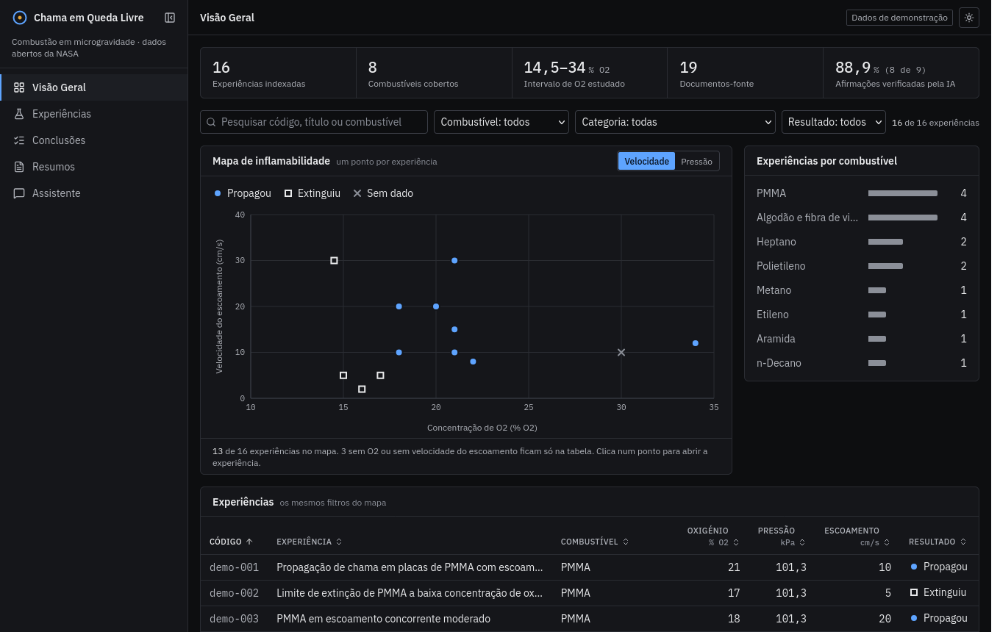
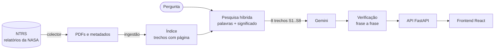

# Chama em Queda Livre

**Combustão em microgravidade · dados abertos da NASA**

Uma ferramenta para consultar o que a NASA publicou sobre fogo em microgravidade e segurança
contra incêndios no espaço, sem ter de ler dezenas de relatórios técnicos. Responde a perguntas em
português, mostra em que condições uma chama se propaga ou se extingue, e indica o documento e a
página de onde vem cada afirmação.

> Projecto independente, feito com dados abertos. Não é um produto oficial da NASA nem tem o seu aval.



*Ecrã "Visão Geral" com dados de demonstração (sintéticos, não são resultados da NASA).*

## Porquê

No espaço o fogo comporta-se de outra maneira. Sem gravidade o ar quente não sobe, a chama fica
esférica e azul, e pode manter-se com menos oxigénio e menos corrente de ar do que na Terra. Saber
em que condições um material arde é o que permite desenhar naves seguras. Essa informação é pública,
mas está espalhada por PDFs longos no servidor de relatórios técnicos da NASA (NTRS).

## O que faz

- **Mapa de inflamabilidade:** um ponto por experiência, com a concentração de oxigénio num eixo e a
  pressão ou a velocidade do escoamento no outro. A forma do ponto diz se a chama se propagou ou se
  extinguiu.
- **Tabela de experiências:** combustível, oxigénio, pressão, escoamento e resultado, com filtros,
  ordenação, detalhe de cada experiência e comparação de 2 ou 3 lado a lado.
- **Assistente:** perguntas livres em português sobre os documentos. Cada frase da resposta cita a
  fonte, e a citação abre o trecho original.
- **Resumos e conclusões:** o resumo de cada documento e respostas a perguntas fixas sobre segurança
  contra incêndios, com selo "Verificado" ou "Por verificar".

## A regra central: nenhuma afirmação sem fonte

O modelo de linguagem só vê os trechos recuperados dos documentos e é obrigado a citar um trecho no
fim de cada frase. Antes de a resposta ser devolvida, cada frase passa por três controlos:

1. **Citação válida:** a frase cita um trecho que existe.
2. **Números na fonte:** todos os números da frase aparecem no trecho citado.
3. **Apoio:** uma segunda chamada ao modelo, no papel de juiz, confirma que o trecho apoia a frase.

A resposta só é marcada como fiável se todas as frases passarem. Quando falha, a interface mostra um
aviso e sublinha as frases sem apoio. Se os documentos não respondem à pergunta, a resposta é
"Não encontrei essa informação nos documentos."

## Como funciona



1. **Recolha:** o colector pesquisa a API pública do NTRS e descarrega os PDFs.
2. **Ingestão:** o texto é extraído página a página e cortado em trechos de cerca de 1200
   caracteres, sem partir frases. Cada trecho guarda o documento e a página de origem.
3. **Pesquisa híbrida:** combina pesquisa por palavras (BM25) com pesquisa por significado
   (embeddings multilingues), o que permite perguntar em português sobre documentos em inglês.
4. **Resposta:** os trechos mais relevantes são enviados ao modelo, numerados `S1`, `S2`…
5. **Verificação:** a resposta é conferida frase a frase, como descrito acima.
6. **Extracção:** para cada documento são extraídos combustível, ambiente, pressão, oxigénio,
   velocidade do escoamento e resultado, cada valor com a sua fonte. Estes dados alimentam o mapa e
   a tabela.

## Estrutura do repositório

| Pasta | Conteúdo |
|---|---|
| [`Backend/`](Backend/) | Serviço Python (FastAPI): colector, ingestão, pesquisa, RAG, verificação, API e CLI. Documentação completa em [`Backend/README.md`](Backend/README.md). |
| [`Frontend/nasa-fire-dashboard/`](Frontend/nasa-fire-dashboard/) | Aplicação web (React, TypeScript, Tailwind, Recharts). Ver [`README.md`](Frontend/nasa-fire-dashboard/README.md). |
| [`docs/`](docs/) | Imagens da documentação. |

## Como correr

### Só a interface, com dados de demonstração

Não precisa do Backend nem de chave de API. Requer Node 20.19 ou superior.

```bash
cd Frontend/nasa-fire-dashboard
npm install
npm run dev
```

Sem o ficheiro `.env`, a aplicação usa dados sintéticos e mostra a etiqueta "Dados de demonstração".

### Sistema completo, com os documentos reais

**1. Backend** (Python 3.11 ou superior):

```bash
cd Backend
python -m venv .venv
source .venv/bin/activate          # Windows: .venv\Scripts\activate
pip install -r requirements.txt
cp .env.example .env               # e preenche GEMINI_API_KEY
python -m app.collect --max 40     # descarrega documentos do NTRS
python -m app.cli index            # indexa os documentos
uvicorn app.api:app --reload --port 8000
```

A chave obtém-se no Google AI Studio. Sem chave o serviço arranca em modo reduzido: a pesquisa por
palavras funciona, mas as perguntas, os resumos, as extracções e as conclusões devolvem o erro 503.

**2. Frontend**, noutro terminal:

```bash
cd Frontend/nasa-fire-dashboard
cp .env.example .env               # VITE_API_URL=http://localhost:8000
npm install
npm run dev
```

Se a porta 8000 estiver ocupada, usa outra no `uvicorn` e a mesma em `VITE_API_URL`.

**3. Preencher os gráficos:** o mapa e a tabela só mostram documentos com dados extraídos. A
extracção faz-se por documento, com `python -m app.cli extract <doc_id>` ou
`GET /extract/{doc_id}`. As conclusões geram-se no ecrã "Conclusões" ou com `POST /conclusions`.

## API

| Método | Rota | Para que serve |
|---|---|---|
| GET | `/health` | Estado do serviço e número de documentos |
| GET | `/documents` | Documentos indexados e as suas categorias |
| GET | `/search` | Pesquisa nos trechos |
| POST | `/ask` | Pergunta com resposta verificada e fontes |
| POST | `/summarize` | Resumo de um documento |
| POST | `/compare` | Comparação de dois ou mais documentos |
| GET | `/extract/{doc_id}` | Dados estruturados de um documento |
| GET | `/extractions` | Todas as extracções já calculadas |
| GET, POST | `/conclusions` | Ler ou gerar as conclusões |
| POST | `/reindex` | Reindexar a pasta de documentos |

As rotas `/ask`, `/summarize` e `/compare` devolvem sempre `resposta`, `fontes` e `verificacao`. Os
formatos completos estão em [`Backend/README.md`](Backend/README.md) e, com o serviço a correr, em
`http://localhost:8000/docs`.

## Testes e verificação

```bash
cd Backend && python -m pytest                              # testes do Backend, sem rede nem chave
cd Frontend/nasa-fire-dashboard && npm run build && npm run lint
```

## Limitações conhecidas

- Os dados de demonstração do frontend são sintéticos e servem só para mostrar a interface.
- As unidades vêm dos documentos tal como estão; o frontend converte pressão para kPa e velocidade
  para cm/s, e ignora unidades que não reconhece.
- Os PDFs digitalizados, sem texto extraível, são ignorados na indexação.
- A qualidade das respostas depende dos documentos indexados e do modelo; a verificação reduz o
  risco de afirmações sem apoio, mas não substitui a leitura da fonte.

## Fontes dos dados

Os documentos vêm do [NASA Technical Reports Server (NTRS)](https://ntrs.nasa.gov/). Os PDFs não
estão no repositório: são descarregados pelo colector.
